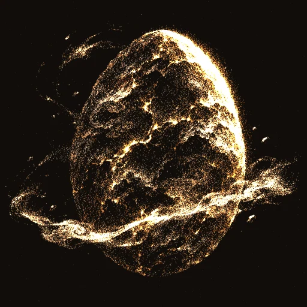

# Particle Story Web Skill

把神话、童话和短篇故事做成可倒放的粒子网页。向下滚动，同一批粒子散开再聚成下一幕。向上滚动，粒子沿原轨迹回去。读到结尾停下来，水流、薄雾或天光还可以继续动。

## 效果预览

| 采样原图 | WebGL 粒子渲染 |
| --- | --- |
|  |  |

插画里的亮处会采样得更密，像素颜色则决定粒子的颜色。每一幕给同一批粒子一组新的目标位置。

<p align="center">
  
</p>

动图由仓库里的渲染器逐帧导出，演示《盘古开天》的前 3 幕和回滚过程。实际页面会等粒子第一帧画好才揭开加载层。

## 在本地体验《盘古开天》

用 Git 下载，使用 Node.js 生成示例，再用 Python 3 启动静态服务。

```sh
git clone https://github.com/onvno/particle-story-web-skill.git
cd particle-story-web-skill
node scripts/scaffold.mjs ../pangu-demo --example
cd ../pangu-demo
node scripts/build-stories.mjs
python3 -m http.server 8741 --bind 127.0.0.1 --directory dist
```

启动后打开页面。试着在两幕之间停住，再往上滚，最后在山河一幕停几秒。停止服务时，在终端按 `Ctrl+C`。[打开本地示例](http://127.0.0.1:8741/)

## 在 Codex 中使用

在你想制作故事的项目目录运行下面的命令，将 Skill 安装到该项目。[OpenAI Codex Skill 文档](https://learn.chatgpt.com/docs/build-skills#where-codex-loads-local-skills)

```sh
mkdir -p .agents/skills
git clone https://github.com/onvno/particle-story-web-skill.git .agents/skills/particle-story-web-skill
```

打开该项目的 Codex 会话，输入下面的调用示例。

> 用 `$particle-story-web-skill` 把《拇指姑娘》做成四幕粒子故事网页，让终幕的花粉和花瓣缓缓漂动。

Skill 会拆分章节、准备可采样的配图，再生成静态网页。故事文字和终幕动效在生成项目的 `stories/` 里配置，图片放在 `dist/art/`，可以为终幕选择流云、潮汐等预设，也可以单独指定会移动或泛光的区域。[故事配置和制作参考](references/story-authoring.md)

## 仓库内容

| 位置 | 用途 |
| --- | --- |
| [SKILL.md](SKILL.md) | Skill 入口和制作流程 |
| [assets/frontend-template/](assets/frontend-template/) | WebGL 渲染器、滚动逻辑、页面生成器和回归测试 |
| [assets/example/](assets/example/) | 《盘古开天》五幕配置与完整插画 |
| [scripts/scaffold.mjs](scripts/scaffold.mjs) | 从模板创建新项目 |

在生成的项目目录运行 `node scripts/test-stories.mjs`，可以验证加载、粒子倒放和终幕启动时机。粒子叙事的视觉参考来自 [Ananta](https://ramayan-scroll.vercel.app/)。
